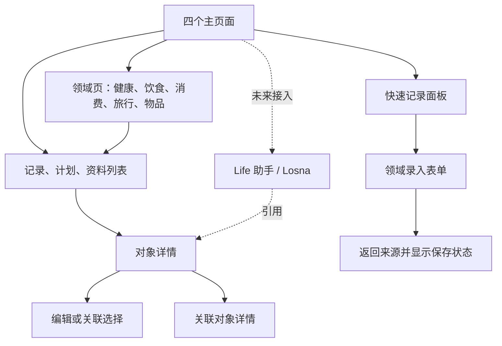

# Life Android 整体体验设计

版本：2026-10-30 · 设计基线 v1 · 整体实施见[交付记录](../execution/android-experience-complete-2026-10-30.md)

2026-10-31 的[事件记录与分类详情设计](event-details-visual-design.md)更新本文的通用详情和雾蓝视觉方向：暗色采用纯黑背景与明亮领域色，按真实事件归组、按数据类型组织详情。该更新尚处设计阶段，本文已交付范围不代表新版已经实施。

本文定义全 App 的功能组织、页面布局和交互行为，作为后续界面设计与开发的共同依据。现状依据为 Android 导航、领域页面、详情、采集、训练与设计系统源码；未将生成图片视为最终界面规范，也未进行真机视觉验收。

## 1. 已确定的方向

- 保留首页卡片堆叠、显示／隐藏与自由排序，不以减少卡片数量作为改版目标。
- 卡片内部围绕内容设计；统一的是排版、层级、边距、状态和操作规则。
- 全局采用暖白／石墨黑底色、雾蓝强调色；健康模块保留原有绿色及指标语义色（用户于本轮实施明确要求），内容图片保留原色。
- 优化整个 Android App：四个主页面、领域入口、列表、详情、表单、选择器、中间流程、设备与采集、设置和状态反馈。
- Life 负责生活事实、页面和操作结果；Agent 后续由 Losna 接入。新体验不能把尚未接入的能力显示为可用。
- 保留手动使用的完整路径；不要求用户通过对话完成所有操作。
- 本文是设计基线；用户已授权整体实施与打包，实际范围和验证见交付记录，服务端不随 App 打包部署。

## 2. 产品结构与导航

### 2.1 四个主页面

| 页面 | 用户来这里做什么 | 主要内容 | 不承担的内容 |
| --- | --- | --- | --- |
| 生活 | 看近况，使用常用功能 | 自定义生活卡片、快捷操作、全部功能 | 全量原始数据和设备配置 |
| 记录 | 找已经发生的事 | 时间线、某一天、领域筛选、活动与采集、往日回忆 | 尚未发生的计划 |
| 计划 | 安排下一步并跟进 | 日程、项目、目标、周期事项、训练入口；未来的助手任务 | 已有物品的完整档案、原始采集材料 |
| 资料 | 找保存下来的内容 | 图片、文件、网页、笔记、票券、搜索 | 尚未归档的全部采集内容 |

底部顺序：生活／记录／＋／计划／资料。中间加号是操作按钮，不是第五个导航页；点开快速记录面板。助手使用独立图标与文字入口，不再用加号同时表达助手。

首页顶部提供搜索、助手入口和更多菜单；更多菜单包含首页编辑、全部功能、提醒、设置。为全部功能保留首页固定可见入口，不依赖某张可隐藏卡片。其他根页顶部优先展示本页搜索或新增操作，不重复铺满所有全局按钮。

### 2.2 页面层级

- 主页面保留底部导航；领域页、详情页、全屏编辑页和执行页隐藏底部导航。
- 每个主页面保留独立位置：筛选、日期、滚动、分页数据、选中分区。
- 返回沿实际进入路径返回。例如餐次 → 关联账目 → 返回餐次，不跳消费首页。
- 深链或系统通知进入详情时，返回上一个有效页面；没有 App 内来源时返回对应根页。
- 同一对象从不同入口进入使用同一详情页面，不维护内容不一致的两套详情。
- 对已在当前返回栈中的对象复用已有页面，避免餐次与账目互跳形成无穷栈。
- 中间页必须有独立用途：筛选、选择、预览、编辑或查看完整信息。只显示一个“继续”按钮的中转页删除。

## 3. 首页卡片系统

### 3.1 通用结构

卡片由“标题与范围 → 主内容 → 辅助信息 → 必要操作”组成。允许省略无用部分，不能为整齐补空信息。标题说明内容，范围说明今天／本月／最近测量等口径。

| 类型 | 内部布局 | 典型卡片 | 主要动作 |
| --- | --- | --- | --- |
| 数据卡 | 核心数字、单位、时间、轻量趋势、最多一组辅助指标 | 身体、睡眠、消费、运动 | 进入对应指标或领域 |
| 行动卡 | 当前事项、下一步、进度、明确按钮 | 训练、待办、补给、接收体重 | 开始／继续／处理 |
| 内容卡 | 可选图片、摘要、时间、关联信息 | 餐次、资料、旅行 | 打开对象 |
| 综合卡 | 一个主摘要与若干相关子项 | 健康总览、当前旅程 | 进入领域；子项可直接下钻 |
| 状态卡 | 当前状态、原因、可执行操作 | 采集中、同步异常、未来助手任务 | 暂停／停止／继续／重试 |

卡片默认整行；仅无长文本、无复杂操作的紧凑指标允许双列。字体放大或窄屏自动恢复单列。完整卡片与紧凑卡片是后续可选尺寸，不要求第一阶段提供任意网格拼贴。

### 3.2 交互与定制

- 卡片背景可点击进入完整内容，内部操作按钮有独立触摸区，点击按钮不触发背景导航。
- 综合卡有多个子项时，标题行是“查看全部”入口；各子项打开各自内容，避免整卡与子项焦点重复。
- 点击卡片中的“开始训练”“记餐”“接收体重”直接进入对应流程，不先绕领域首页。
- 编辑首页使用独立编辑模式：显示拖动柄、隐藏按钮、可添加卡片；同时保留上移／下移，支持无障碍操作。
- 首页顺序稳定，不根据数据自动搬动卡片；允许用户置顶。已有顺序迁移保留，新卡片不反复强插首位。
- 健康总览与单独睡眠、身体、运动卡都保留，用户决定组合。隐藏卡片不关闭功能、不删除数据。
- 空卡片缩为简洁说明和一个入口，仍保留位置。单张卡片失败不替换全屏，不影响其他卡片。
- 主动录音或地点采集显示常驻状态条及停止入口；不能因用户隐藏首页状态卡而失去控制入口。

## 4. 三个其他主页面

### 4.1 记录

布局：标题与搜索 → 日期定位和领域筛选 → 按天分组的记录卡／列表 → 分页尾部。

- 时间线为默认视图，“某一天”使用日期选择器和前后一天切换，不要求输入日期字符串。
- 同一天可使用一个分组卡容纳多行记录；照片餐次、行程等内容较丰富的记录可独立成卡。
- 每行优先显示标题、时间、核心值；领域图标辅助识别，来源和同步状态使用次级文字。
- 搜索进入同一页面的搜索模式，明确当前范围；退出后恢复原时间线位置。筛选无结果提供“清除筛选”。
- 采集活动提供清晰的“活动与采集”入口和可选来源筛选。连续采集不逐条挤满默认生活时间线，可按活动段汇总后展开原始来源；汇总不改变原记录。
- 某一天的回顾与往日回忆放在该日内容之后，可折叠；无历史材料不生成回忆文案。
- 关联餐次、账目等依然是不同事实。只对已有显式关联显示关联入口，不按相似标题自动合并。

### 4.2 计划

布局：标题与新增 → 日程／项目／目标三个分区 → 当前分区内容。

- 日程：默认今天，支持周视图和日期定位；按时间排列，未指定时间的事项单独分组。
- 项目：进行中优先，展示目标、下一行动、完成进度；已完成折叠，不把历史项目混成长期大列表。
- 目标：展示明确目标、适用周期与已有进展。偏好从这里进入独立列表，用生活语言编辑。
- 训练、旅行、周期费用保留明确快捷入口，并在日程中投影相关事项；点击进入唯一领域详情。
- 物品完整管理移到全部功能与物品领域；待维护、待补给事项仍进入日程。
- 回顾以固定入口保留；已发生的生活回顾同时可从记录页找到，使用相同详情。
- 未来助手任务进入项目或日程对应位置，状态区分进行中／需要补充／完成／失败，不新增一个独立管理中心。
- 标记周期账单“已处理”不表示已付款；记录付款是独立动作，文案必须区分。

### 4.3 资料

布局：标题与搜索／新增 → 全部、图片、文件、链接、笔记、票券筛选 → 最近内容。

- 图片以缩略图为主，文件和笔记以紧凑列表为主；不强制所有类型使用大封面。
- 搜索保留类型与日期范围；能定位的原文命中显示摘要，不能定位的内容不伪造高亮。
- 票券先呈现名称、有效时间和使用信息；原始文件随时可打开。
- 未配置识别能力、识别中、识别失败只影响处理区域，原件仍可阅读。
- 原件与整理后的内容有明确切换；编辑整理内容不覆盖原件。
- 普通采集内容需显式归档或既定规则归档才成为资料；删除采集来源与删除独立资料副本分别说明。

## 5. 领域页及下钻页面

领域页采用“概览＋少量稳定分区＋完整功能入口”，不让一排大量标签承担所有导航。内容仍使用卡片，表格和长记录使用分组列表。

| 领域 | 一级布局 | 二级页面与中间页 | 详情页重点 |
| --- | --- | --- | --- |
| 健康 | 总览、身体、活动、睡眠；训练快捷入口 | 单指标趋势、测量历史、设备与来源、个人参考范围、专项记录 | 数值与测量时间、单位、同类趋势、来源；设备原始数据只读 |
| 饮食 | 按日餐次、营养摘要、计划与食材入口 | 食谱列表／详情、餐食计划、购物清单、食物库存、统计 | 餐照、食物与份量、已知营养、关联付款、备注 |
| 消费 | 月份切换、概览、明细；预算与管理入口 | 预算、周期费用、想买、消耗品、次卡、账单导入与核对、统计 | 金额和币种、商家、分类、发生时间、退款、来源及关联 |
| 旅行 | 旅程列表与当前旅程、地图入口 | 旅程详情内的日程／预订／清单；地图、地点详情、交通、离线导出 | 当天安排、住宿跨夜、交通到达、预订状态、实际到访 |
| 物品 | 搜索、分类／位置、维护与到期筛选 | 使用与维护记录、补给、关联资料选择 | 名称图片、持有状态、位置、购买、保修、维护、说明书 |

### 5.1 健康与训练

- 健康总览展示最关注的数据，完整指标库在身体页；指标显示／隐藏沿用已有偏好。
- 单指标页按“当前值 → 时间范围 → 可读图表 → 测量历史”组织。点图表显示日期、数值和单位，不只依赖颜色；同时提供列表。
- 来源、统计口径和覆盖不足紧邻相关数据，复杂说明展开阅读；无权限、无数据与真实零值区分。
- 睡眠优先呈现主睡眠、睡眠时段与趋势，其余睡眠独立展示，不把跨源重复记录直接相加。
- 训练拆成三种页面：训练入口（菜单／自由训练）→ 备课页（动作选择与排序）→ 执行页（当前动作、重量次数、完成组、休息计时）。
- 动作库使用可搜索列表；动作详情展示要领与参考链接；选中后返回备课页，保留搜索位置。
- 执行页使用可单手点击的完成按钮，记录已完成组；离开页面保留训练草稿并显示继续入口。结束时只保存实际完成组，不能把整份菜单认作已训练。
- 个人专项记录保留功能与历史入口，使用独立页面，不为精简健康标签而删除。

### 5.2 饮食与食材

- 早餐、午餐、晚餐及加餐按日分组；空餐次只展示轻量“添加”，有照片时自然展示图片。
- 添加餐次可连续添加食物行、份量和单位；拍照是附件动作，识别是否可用单独表达。
- 一次餐次编辑可改全部食物行，不逐行进入独立确认页。
- 餐食计划 → 生成购物清单 → 逐项采购 → 库存，是相互关联的页面；计划完成或购买食材不自动代表吃过。
- 库存按将到期／已到期／日期未知筛选；到期状态来自已有规则，手工更正保留原批次身份。
- 饮食统计与消费统计区分食用、购买、订单和金额口径，不因为共用卡片组件而混成一个数字。

### 5.3 消费、核对与次卡

- 月份为页面级状态，进入明细后返回仍是原月份；不同币种独立展示。
- 预算卡写清支出使用口径；净支出、毛支出和退款分别命名，不能视觉改版时统一成“已花”。
- 退款从原交易详情进入，或在退款表单中搜索原交易；展示所选交易摘要，不要求填写内部 ID。
- 账单流程：导入入口 → 文件／来源选择 → 批次结果。无冲突的普通操作按现有规则直接完成；需补充或冲突项目才进入逐条核对页。
- 核对页显示“来源观察／已存记录／差异”，一次只突出当前问题，保存后回到原批次及原位置。
- 次卡列表展示剩余次数／余额与有效期；详情显示使用历史，“记一次使用”打开小表单。
- 消耗品的估算余量与实际使用明确标记；想买仍是意向，不能提前计入消费。

### 5.4 旅行与地图

- 旅程详情作为唯一工作入口，整合原通用旅程详情和行程工作台，避免读完详情再跳另一页才能编辑。
- 顶部显示旅程名称与日期，下面为日程／预订／清单；地图是可从旅程和领域入口打开的完整页面。
- 日程使用日期条及按时间排列的卡片；住宿同时表达入住、续住、退房，交通保留出发与到达日期。
- 待定、已确认、已取消的预订有文字和图标区分，不能仅用颜色区分。
- 地图使用上方地图、下方可展开地点面板。点标记与点列表双向选中，返回恢复缩放、日期和已选地点。
- 计划路线、道路路线、上传轨迹与实际到访各自有图例；不能用同一条线暗示都已发生。
- 行程编辑从当前日期或地点直接进入并预填；保存后返回该天该位置。
- 离线导出为“生成 → 保存到文件”，不增加审核页；失败保留当前旅程状态并能重试。

## 6. 统一详情页体系

### 6.1 结构

1. 顶栏：返回、简短类型标题、编辑／更多操作。
2. 主摘要：核心内容或数字、名称、发生时间、业务状态。
3. 主要内容：领域专属的图片、条目、图表、日程或正文。
4. 关联内容：实际存在的账目、餐次、资料、物品或计划关系。
5. 来源与历史：来源、修订、覆盖与处理说明，技术标识默认折叠。
6. 操作：至多一个固定主要操作；普通阅读页不强放底部按钮。

金额详情突出金额；餐次详情突出食物；资料详情优先阅读；训练详情突出实际完成内容。统一骨架不能把所有对象都显示成“字段名：字段值”大表。

### 6.2 操作规则

- 高频编辑放顶栏；退款、补照片、记使用等领域动作放相关区域或固定主操作。删除与低频管理放更多菜单。
- 源设备记录不可编辑的字段显示只读原因；只在当前合同支持更正时开放编辑，不伪造通用修改能力。
- 不需要编辑的详情不出现灰色不可用按钮墙。
- 来源可以展开或跳到来源详情，回来保留原阅读位置。
- 内容更新时保留正在阅读的快照，提示“有新内容”；由用户选择刷新，避免段落和列表突然移动。
- 关联对象不可访问时，只显示必要的不可用状态，不泄露被限制对象的信息。

## 7. 中间页、表单与弹层

| 场景 | 容器 | 行为 |
| --- | --- | --- |
| 快速记录类型选择 | 底部面板 | 最近常用类型＋全部类型，点选直达表单 |
| 日期、排序、简单筛选 | 底部面板／系统选择器 | 临时选择；应用后显示已选条件；关闭可放弃本次修改 |
| 短编辑（备注、日期等） | 底部面板 | 保存位置固定，键盘不遮挡；失败保留输入 |
| 多行餐次、行程、计划、次卡等复杂编辑 | 全屏表单 | 分区组织，辅助字段可展开；不用多层弹窗嵌套 |
| 搜索选择关联对象 | 全屏选择页 | 搜索、分页、对象摘要；选中后返回原表单，不丢输入 |
| 图片、文件或原文预览 | 全屏查看器 | 阅读优先，返回原位置；调用系统打开时说明离开 App |
| 训练、录音等持续执行 | 独立执行页 | 状态、当前动作和结束入口常驻 |
| 删除等高影响动作 | 当前操作点的确认弹窗 | 写清对象与实际后果；确认后在原上下文反馈 |

表单共同规则：

- 预填入口已知的日期、领域和关联对象；用户可改的内容保留可编辑性，不静默猜测关键事实。
- 必填项先展示；可选项集中在“更多信息”，有值时展示摘要，便于发现和更正。
- 数字键盘、金额小数、单位、币种各司其职；日期使用选择器，避免把 API 格式变成主要输入方式。
- 验证错误紧邻字段，提交时定位第一处错误；网络错误留在表单，不清空输入。
- 草稿按账号和对象隔离。系统返回、手势返回和顶栏返回一致；能可靠保存草稿时直接返回并提示，下次继续。确有未保存且无法保留的输入时才询问放弃。
- 点击保存后锁定本次提交，避免重复动作；成功返回调用页面并更新相关行，不必进入独立成功页再点“完成”。
- 本地入队反馈“已保存到本机，待同步”；服务端确认后才显示已同步。结果未知时显示“正在确认结果”，不能诱导用户重新新建同一条记录。
- 多条连续录入可提供“保存并继续”，完成后清理已保存字段，保留用户选择的公共日期等适当上下文。
- 撤销仅在现有业务能力可以可靠反转时提供；不支持的操作提供更正入口，不显示虚假的撤销按钮。

## 8. 活动、采集与回顾

当前采集界面包含使用记录、录音、地点、订单、回顾、分类、导出和保留策略。按用途拆分，保持既有入口可达。

| 页面 | 内容 | 关键交互 |
| --- | --- | --- |
| 活动概览 | 日期、应用使用、活动段、项目投入、覆盖说明 | 切换日期、查看来源、手动记录活动 |
| 采集控制 | 录音、地点、截图说明、屏幕内容与应用选择 | 当前状态清晰，开始／暂停／停止；权限按需引导 |
| 来源详情 | 原文／图片／音频、转写、时间、来源、关联 | 回听、定位转写、更正、归档、分类、删除 |
| 订单关联 | 已观察订单、实际账目关系、冲突状态 | 查看来源和账目；处理缺失／冲突 |
| 回顾 | 日／周／月范围、摘要、指标、证据 | 查看来源；失效提示与重算 |
| 采集设置 | 应用范围、上传与处理、保留策略、导出恢复 | 业务设置归组；高影响清理明确范围 |

- 正在录音时，即使离开采集页，App 内状态与系统通知都提供返回和停止；系统终止不能表现为仍在录音。
- 处理阶段用“待同步／待转写／处理中／可查看／处理失败”，区分原件是否仍可用。
- 转写详情以音频播放器和分段正文为主体；点分段跳到对应位置，更正只作用于选中段。
- 屏幕内容采集的应用范围和上传状态始终可检查，不用隐藏设置换取视觉简洁。
- 分类、项目关联采用选择器；“作为此应用以后的默认分类”是显式选项，不默认为开启。
- 导出／恢复显示范围与结果；删除和保留策略调整说明会影响的内容，不把原件删除包装为普通归档。
- 缺失时段保持未知，应用使用时长不命名为专注时长，目标页不据不完整采集认定全天未达标。

## 9. 设备、设置、提醒与系统入口

- 设置首页按账号、外观、设备与数据来源、同步、采集、提醒、其他项目、关于归组；每行显示必要摘要，进入二级页再展示详细控制。
- 设备列表 → 单设备详情：连接状态、最近有效数据、最近同步、所需权限、明确操作。体重接收页用一个大数值与状态过程，不把底层字段铺满首屏。
- 同步页使用“待同步／正在确认／需要处理／已完成”，详细诊断按需展开；清理队列时区分失败项目，不能把可能丢失的内容描述为无影响清理。
- 权限在使用对应功能时解释用途并跳系统设置；返回后刷新授权状态。拒绝后保留手动或其他可用路径。
- 提醒页按需要处理与历史分组；稍后提醒可用底部时间选择器，打开对象后返回原提醒位置。
- 系统分享保留当前账号归属提示与材料预览，用户确认收存后直接显示结果；附件复制或上传中的状态可恢复。
- 登录、会话失效与账号切换保留原有安全边界；恢复后回到有效来源页面，不展示其他账号草稿。
- 其他项目使用清晰列表，标明在 App 或浏览器打开；继续由现有连接实现处理，不因改版共享或搬移账号凭据。

## 10. Losna 接入后的助手体验

### 10.1 产品边界

Life 提供上下文选择、对话呈现、结果卡片、对象导航和执行回执。Losna 负责后续 Agent 编排；业务写入仍通过 Life 现有共同执行器。本文不定义或假定 Losna 已具备某个新协议，接入适配需另行核实。

- 当前已有助手能力在迁移期间保持原有可用性并明确实际状态；未接入 Losna 的入口不宣称由 Losna 执行。
- 功能未接入时不展示可点击的假建议和假任务进度，也不强制用户配置才能使用普通记录功能。
- 用户界面统一叫 Life 助手，设置中说明连接来源；无需在每张卡片露出后端名称。

### 10.2 页面与交互

- 短请求可以从底部面板发起，连续对话进入独立页面。历史会话为列表，不横向堆积标签。
- 从领域或详情进入时显示“参考：当前旅程／本月消费”等可移除的上下文；上下文有边界，不默认为所有生活数据。
- 回复采用短说明＋领域结果卡。草案、已入队、已提交明确区别，只有可信回执才能标记已完成。
- 普通明确写入遵循直接执行原则。计划卡是“草案”还是“已创建”取决于用户意图与实际执行结果，不为了使用卡片统一增加确认。
- 缺少事实就在对话中问一项，能提供可选答案时提供短选项；不跳审批中心。
- 长任务离开对话后仍可从计划页找到；断线显示恢复中，重连继续同一任务，不自动新建重复任务。
- 任务取消、暂停、撤销等按钮只在接入能力实际支持时出现；取消请求不等于已取消。
- 来源引用打开原详情，返回回到原消息。执行过程默认折叠，用户需要时查看状态与结果依据。

## 11. 视觉与组件规范

| 项目 | 设计规则 |
| --- | --- |
| 基础色 | 浅色背景 #F7F7F5、内容面 #FFFFFF、文字 #202124；深色背景 #141416、内容面 #202023、文字 #F1F1F3 |
| 强调色 | 浅色 #526E9E、深色 #9AB1D7；用于主要操作、选中与少量趋势 |
| 状态色 | 成功用勾选与文字，可配雾蓝；警告用琥珀，错误用克制的红色；健康模块保留原有绿色；其他区域使用全局雾蓝 |
| 图表 | 蓝、灰、低饱和暖色配合图例、线型与文字；不依赖颜色区分，不以红绿表达好坏 |
| 字体 | 系统中文无衬线；正文 16sp 为主、辅助 13–14sp、标题 20–28sp、重点数字 28–36sp；字号随系统缩放 |
| 间距 | 4／8／12／16／20／24／32dp；手机页边距 20dp，卡片内边距 16–20dp，卡间距 12–16dp |
| 形状 | 普通卡片 18dp、输入区 12dp、底部面板顶部 24dp；无需每层都嵌套圆角容器 |
| 层次 | 背景与内容面形成分层，必要时细边线；不叠加彩色描边、渐变和重阴影 |
| 图标 | 同一套线性图标；选中状态可有填充变化；避免汉字徽章与多套装饰符号混用 |
| 触摸区 | 交互目标至少 48dp，图标可以较小；主按钮高度约 48–52dp |
| 动效 | 约 160–240ms，用于展开、切换和反馈；尊重系统减少动态效果，不用弹跳打断阅读 |

这些数值是初始设计令牌，实际成对前景／背景颜色需验证对比度，不能仅按色号认定可读。正文对比度目标至少 4.5:1，大字及必要非文本图形至少 3:1。

共用组件：页面骨架、领域顶栏、日期导航、卡片标题、核心指标、趋势图、列表行、状态标签、关联对象行、来源折叠区、底部操作区、表单字段、搜索选择器、局部状态面板。组件复用不抹平领域差异。

## 12. 全局状态与连续性

| 状态 | 用户看到什么 | 后续操作 |
| --- | --- | --- |
| 首次加载 | 与实际内容形状接近的轻量骨架 | 慢请求可取消／返回；不无限无说明旋转 |
| 后台刷新 | 保留旧内容，小范围刷新状态 | 成功更新相关区域，失败保留内容 |
| 真正为空 | 一句原因＋对应新增入口 | 直接开始记录 |
| 筛选无结果 | 当前条件与清除入口 | 清除或调整筛选 |
| 局部失败 | 卡片或区块内错误 | 只重试该区块 |
| 离线可读 | 缓存内容与最近更新时间 | 继续浏览，不伪装成最新数据 |
| 无缓存离线 | 说明当前内容未保存到本机 | 返回或重试 |
| 写入已入队 | 原页面显示待同步标记 | 使用既有队列继续同一命令 |
| 版本冲突 | 保留输入，提示记录已有更新 | 查看最新内容并重新应用改动 |
| 附件或分页失败 | 已加载内容不丢失 | 在失败位置重试 |
| 权限不可用 | 具体能力缺失及可用替代 | 按需授权；不显示为零数据 |

不使用“知道了”弹窗报告每一次成功。普通成功使用短暂提示和对象更新；需要用户处理的持续状态留在相关内容附近。

支持窄屏、字体放大、屏幕阅读器、键盘与系统返回；多列在空间不足时降为单列。加载更多保留可点击入口；长列表使用惰性加载；大图解码、图表与后台刷新不阻塞主要操作。

## 13. 代表性完整流程

| 流程 | 页面顺序 | 完成后的落点与异常 |
| --- | --- | --- |
| 记一餐 | 首页饮食卡 → 已预填日期的餐次表单 → 添加食物／餐照 → 保存 | 回到首页或原饮食页，更新卡片；上传未完成保留标记 |
| 查消费并更正 | 记录筛选 → 账目详情 → 编辑 | 回到同一详情；再返回恢复筛选位置，冲突保留输入 |
| 开始训练 | 首页训练卡 → 备课或继续执行 → 完成组 → 结束保存 | 回到训练结果；中途返回有继续入口 |
| 调整旅行 | 旅行卡 → 当前旅程与所选日 → 编辑安排／选择地点 → 保存 | 原日期和位置；地图选择返回同一表单 |
| 核对导入 | 消费管理 → 导入批次 → 待处理记录 → 查看来源／补充 | 回到批次，更新处理数量，不把候选当已入账 |
| 录音回顾 | 采集控制 → 开始录音 → 离开／返回 → 停止 → 来源详情 | 音频可用与转写状态分别显示；失败可重试 |
| 整理资料 | 系统分享 → 账号与材料预览 → 收存 → 资料详情 | 原件先可用；识别稍后更新，不覆盖用户编辑 |
| 助手安排（未来） | 当前旅程 → 助手与可见上下文 → 补充必要事实 → 结果卡 | 打开相同行程对象；返回原会话；断线恢复同一任务 |

## 14. 与现有实现的对应与改造顺序

### 14.1 功能覆盖对照

| 当前页面／代码入口 | 新设计归属 | 处理方式 |
| --- | --- | --- |
| TodayVisualScreen / TodayCardLayoutStore | 生活与首页编辑 | 保留卡片类型、用户排序与隐藏状态，重做卡片内部 |
| RecordsVisualScreen / DayMemorySection | 记录、某一天、回忆 | 整理日期和搜索交互，保持来源可追溯 |
| PlansVisualScreen / PlanDetailScreen | 计划、项目详情 | 按日程／项目／目标组织，保留行动和回顾 |
| PersonalAgentScreen | 目标偏好、任务详情 | 拆分表单与列表，未来承接 Losna 任务状态 |
| LibraryVisualScreen / DetailScreen | 资料列表与专属详情 | 阅读优先，保留原件、处理与修订能力 |
| HealthWorkspaceScreen / ReleaseHistoryScreen | 健康与专项记录 | 保留指标和专项历史，训练独立执行流程 |
| TrainingMenuWorkspace | 训练入口、备课、执行 | 同一数据模型分三种页面状态，保留实际组语义 |
| MealsWorkspaceScreen / NativeMealPlanningSection | 饮食、食谱、计划、购物与库存 | 从单页长内容拆成明确工作页面 |
| MoneyWorkspaceScreen / NativeMoneyPlanningSection | 消费、预算、周期费用、想买 | 减少一级标签，完整功能从管理入口进入 |
| NativeUseCycleSection / NativeServiceCardsSection | 消耗品与次卡 | 独立列表、详情与短操作表单 |
| NativeMoneyImportSection / ConsumptionStatsScreen | 导入核对与统计 | 保留来源、口径与覆盖说明 |
| TravelWorkspaceScreen / DetailScreen 的旅程分支 | 唯一旅程详情 | 合并重复阅读与编辑入口，保留日程、预订、清单、离线 |
| TravelMapWorkspace / TravelNativeMap | 全屏地图与地点面板 | 统一地点选择、地图返回和日期状态 |
| ItemsWorkspaceScreen / OwnedItemDetailScreen | 物品领域与详情 | 完整档案移出计划主分区，维护事项仍留日程 |
| ReviewDetailScreen | 回顾详情 | 保留指标、覆盖、证据和来源打开能力 |
| LifeComposerHost / DetailEditSheet | 快速记录、表单、助手 | 分开记录与助手，按复杂度选择面板或全屏 |
| ActivityCaptureScreen / CaptureSuitePanel / CaptureCompletionPanel | 活动、采集、来源、订单、回顾、采集设置 | 拆开控制、阅读与设置，保留现有能力 |
| CaptureSourceScreen | 来源详情 | 音频、转写、原文、分类、归档与删除按内容组织 |
| SettingsScreen / ScaleSettingsDialog / DeviceSyncPanel | 设置、设备详情、同步 | 按职责分组，术语生活化，不改变权限和秘密边界 |
| InboxScreen / FeaturesScreen / ProjectDirectoryScreen | 提醒、全部功能、其他项目 | 保留固定可达入口，统一导航和反馈 |
| SignInScreen / ShareIngressDialog | 登录与系统分享 | 统一外观，保留账号归属及恢复边界 |

### 14.2 分阶段实施

1. 设计系统和导航：颜色、字体、卡片与列表、共用状态；区分快速记录与助手；验证根页状态恢复。
2. 四个主页面和通用详情／表单：完成生活卡片、记录、计划、资料；选账目和餐次作为详情样板。
3. 领域流程：健康与训练、饮食、消费与核对、旅行与地图、物品与次卡逐一落地，并复核所有旧入口。
4. 采集、设备、提醒和设置：拆分复杂长页，验证持续任务、权限返回、来源与导出流程。
5. Losna 接入：在实际能力核实后实现上下文、对话、任务状态与结果卡，复用前面形成的对象页面。

各阶段交付完整可用的纵向流程，不用占位按钮替代未完成能力。仅移动页面或更换组件的工作不应顺带改业务合同；草稿恢复、聚合展示、全局搜索等需要补充能力的项目应单独核实已有支持并列出开发范围。

### 14.3 验收标准

- 所有现有功能均能从新入口找到；隐藏卡片不影响功能可达性。
- 明确入口的操作不经过纯导航中转页；编辑保存后回到原对象与原上下文。
- 根页切换、详情返回、关联跳转、系统权限返回和进程恢复分别验证，草稿不得跨账号出现。
- 验证长标题、多币种、无照片、无数据、部分数据、离线、冲突、附件失败与分页失败。
- 浅深主题、约 360dp 窄屏、较大手机宽度、字体 200% 和 TalkBack 均无关键操作遮挡或信息丢失。
- 图表有文字／列表替代；状态不只依赖颜色；保存状态不混淆本地入队与已提交。
- 训练只保存完成组；计划不当事实；候选不当账目；缺失不当零；资料原件不被整理内容覆盖。
- 真机确认滚动、键盘、安全区、单手点击、录音持续状态及地图交互后，再认为视觉与交互验收完成。

## 15. 参考与后续设计材料

采用 [Things](https://culturedcode.com/things/) 的日常任务组织、[Linear 的界面层级原则](https://linear.app/now/behind-the-latest-design-refresh)以及 [Artifacts 的可操作结果思想](https://www.anthropic.com/news/build-artifacts)作为参考；这些是设计借鉴，不代表照搬其页面或要求购买服务。

下一阶段按照本设计输出代表性流程线框与组件样板：生活卡片、领域概览、列表、对象详情、复杂编辑、选择器、训练执行、采集来源及助手结果。先验证功能组织和返回路径，再细化最终视觉。
