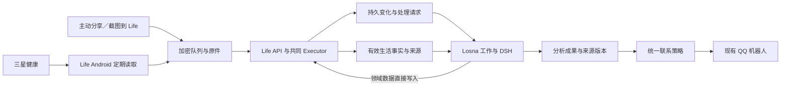

# 健康后台同步、主动分享与 Losna 分析设计

[2026-10-31 实施范围与验证](../execution/health-losna-2026-10-31.md)；下文保留完整目标设计，已实现与待增强范围以实施记录为准。
日期：2026-10-31。状态：**待实施设计**；本次只核对源码、历史方案与官方接口，不代表已启用 30 分钟同步或自动分析。源码基线：Life `0838e1b`、Losna `c4fa8b0`。

## 1. 决策与体验

先实现“分享／截图到 Life → 自动交给 Losna 处理 → 需要写入的数据直接写入 Life，分析结果由现有 QQ 机器人通知”，同时把既有三星健康同步完善为默认约 30 分钟。暂不把 Losna 聊天界面嵌入 Life，也不等待独立伙伴 App。

2026-10-31 按用户补充收敛首期范围：Life 暂不新增分析结果卡片、报告页或收件箱结果展示；分析、建议与必要追问由 Losna 通过现有 QQ 机器人完成。需要归档、记录、标准化和更正的数据直接按已明确意图或既有规则处理，不等待结果展示或逐项确认。

Life 保存生活事实、原件、修订和业务回执；Losna 负责理解意图、调用工具、联合分析、持续跟进与表达。两种输入汇入同一处理链，数据同步频率与模型调用、通知频率分别控制。

这延续两个参考聊天的决定：`01a18bed-518e-7101-b171-72799757980e` 将独立伙伴应用与 Life 领域数据分开；`01a18c6c-1e11-7a33-926b-0c55c2a1f579` 随后完成 NAS 常驻 Losna 的插件化。后者的手机方案只是参考，不能将“先做手机伙伴”当成本次前置。Losna 侧对应设计见 [Life 输入与健康跟进](../../../shadow-losna/docs/life-health-followup.md)；跨仓链接要求同级工作区。

| 场景 | 用户看到的行为 |
| --- | --- |
| 分享午饭照片，附言“这是午饭，帮我记录并看看” | Life 先收好原图；Losna 识别食物，明确事实直接记录，估算明确标注；回复本餐观察和一条可行建议 |
| 只分享一张外卖订单／菜单 | 归档并提取信息；不把下单或菜单自动当作已经吃过 |
| 分享三星睡眠或体检截图 | 提取可核实的字段和日期，保留来源；与已有数据对照，已有记录不再重复入账 |
| 手机后台同步健康数据 | 健康卡片更新；普通步数增长不发消息 |
| “结合最近饮食和睡眠看看” | 联合已有 7／30／90 天复盘、有效目标和实际训练，先说明覆盖，再给建议 |
| “这张只是参考”“我只吃了一半” | 就地修订本次处理和相关事实，旧分析标为过期；不要求进入审核中心 |
| 只想收藏某材料 | 分享入口可选“仅保存”；以后也可随时暂停自动分析 |

## 2. 已有能力与实际缺口

| 已核对位置 | 已有 | 本次增量 |
| --- | --- | --- |
| `client/android/app/src/samsung/kotlin/com/shadow/life/SamsungSync.kt` | Samsung Data SDK 直读，1 小时唯一周期任务、前台启动补读；首次或权限变化回读 30 天，常规回看 2–30 天；分页、原件归档、部分标准投影、互斥 | 30 分钟配置；分类型进度、删除／迟到更正、完整轮次回执、持久互斥与覆盖状态 |
| `SamsungHealthBridge.kt`、`app/build.gradle.kts` | 外置 AAR 存在才编入三星实现；不可用时有提示 | 连接页显示实际安装能力，不按仓库源码推定用户安装包可用 |
| `HealthConnectSync.kt` | 体重、步数、睡眠、运动；变化 token、删除、分批入队及回执后续读；后台权限探测 | 当前构建默认关闭且仅一次性调度；作为备选提供方时再补周期调度和逐类来源选择 |
| `SyncWorker.kt` | 加密附件、批量上传、原命令回执恢复 | 区分读取、排队、服务端提交与标准化状态；分析进度由 Losna 管理 |
| `NativeLifeRepository.kt`、`capture-suite-schemas.ts` | 分享文字／图片、截图原件、活动材料及 OCR 通道 | 分享批次和处理意图持久化；自动处理请求；后台回执关联 |
| [健康饮食复盘](wellness-review.md) | `life.wellness_review`，6 项营养、体重、主睡眠、实际训练、覆盖、前期对照 | Losna 按需调用并解释；其他指标按需补查询，不重算另一套营养统计 |
| Losna `src/life-changes.js` | 已知对象的订阅、游标与 ack、失效处理 | 持续接收“新分享／新有效健康事实”的入口；原有单对象 watch 不能自动覆盖新对象 |

三星 SDK 枚举里有营养、饮水、能量分数等，不代表都已映射为 Life 可分析事实。现有归档与标准投影分开验收。健康展示语义继续遵守 [既有口径](health-display-semantics.md)。

## 3. 三星健康后台读取

### 3.1 提供方与调度

默认沿用已存在的 Samsung Data SDK 直读，Health Connect 作可选兼容来源。两者都在手机上读取；NAS 的定时任务不能替代手机读取。三星设备向手机健康 App 的同步延迟也不受 Life 控制。

产品默认周期为 30 分钟，可选 15／30／60／120 分钟或暂停；使用唯一 PeriodicWorkRequest，不用精确闹钟或永久前台服务强保频率。Android 周期任务最小间隔为 15 分钟，受 Doze、电池策略影响，并非准点承诺。[Android 周期工作官方说明](https://developer.android.com/reference/androidx/work/PeriodicWorkRequest)

首次连接、用户点“立即同步”、恢复权限和回到前台且数据过期时补读；同一账号、设备、提供方只有一个有效读取轮次。配置改变更新原周期任务，不产生第二套定时器。退出账号取消周期与即时工作；执行每页前检查主体和授权代次，防止切账号后续传。

先将现有周期改为可配置并补全状态；后续把“本机读取”和“联网上传”解耦：读取不因断网停止，上传仍用网络约束。健康读取只在受限加密存储和队列容量允许时执行；积压达到上限后暂停读取，不丢弃未提交数据。队列端恢复后继续原轮次。

### 3.2 增量、幂等与来源

- 按账号／主体、设备、提供方、数据类型保存 checkpoint。SDK 支持 changes 的类型使用 UPSERT／DELETE，其他类型按有界时间窗重读；锁定本机 AAR 版本并逐类验证，不能只按在线最新文档编程。三星官方提供变化读取，但能力依数据类型而定。[Samsung 数据访问](https://developer.samsung.com/health/data/guide/features/data-access.html)
- 首次默认回读最近 30 天；常规窗口保留至少 48 小时重叠，修正夜间睡眠和当日汇总。每日低频补查最近 7 天可变汇总；更早补齐由用户选择范围。持久记录本轮实际覆盖，不宣称已扫描全部历史。
- 保留 `source_record_id`、原来源、数据类型、源修订／更新时间、内容摘要、解析版本、时区／偏移。相同内容重复读取不产生新事实事件。聚合值用内容摘要判变和单调修订；现有“历史日末时间作为版本”不足以表达历史汇总更正，需替换并迁移身份映射。
- 两级进度：本机分页游标仅在数据和队列原子落盘后推进；服务端已提交水位仅在同轮全部必要回执确认后推进。标准化异步完成另有状态。不得将 `last_sync` 或单条 `committed` 当作整轮完成。
- 每类数据独立成功／失败；少一项权限不阻塞其他类别，也不反复弹授权框。错误区分未授权、SDK 不可用、临时失败、等待网络、上传受阻、标准化失败。
- 同一物理来源经 Samsung 和 Health Connect 重复出现时保留原件，以逐类主来源与映射选一个有效事实；不能只因获得 HC 权限就跳过三星投影。切换前先验证目标来源的覆盖与新鲜度；切换不双算步数、睡眠和运动热量，不自动把相似时间记录删掉。
- 删除使用来源墓碑使派生事实失效；整窗不见某记录只在权限和完整扫描均可证明时才判断删除。局部失败／撤权／窗口外记录不能视作删除；独立人工更正保留来源和冲突状态。
- Health Connect 每类型 token 持久化，token 过期走有界重扫与来源 ID 去重；不能清空 Life 全部健康记录。[Health Connect 同步规则](https://developer.android.com/health-and-fitness/health-connect/sync-data)

### 3.3 连接与可见状态

健康设置提供“后台同步、同步间隔、数据类型、立即同步”，并显示最近读取、最近入库、数据实际截至时间、缺失类型与积压。页面文案为“约每 30 分钟，系统可能延后”；不能用下一预计时间制造精确保证。三倍配置间隔仍未成功时显示陈旧提示，不因夜里手表未上传就诊断异常。

三星直读需要安装包包含匹配 SDK，并验证当前包身份、签名和三星访问条件。官方分发要求合作方注册，开发模式仅用于测试；本轮不假设当前安装包已完成合作注册，不更换签名、不申请权限。[Samsung 应用流程](https://developer.samsung.com/health/data/process.html)

Health Connect 路径需逐项读取权限、后台功能可用且获得后台读取权限；不支持时降级为前台同步。更久历史读取按实际授权范围提供。三星同步到 HC 的类型取决于应用版本和设备实测，不能将 HC 当作三星所有字段的完整镜像。[后台读取](https://developer.android.com/health-and-fitness/health-connect/read-data)、[三星与 HC](https://developer.samsung.com/health/blog/en/accessing-samsung-health-data-through-health-connect)

## 4. 分享／截图触发处理

### 4.1 一次分享是一个批次

沿用 `ingressId`，增加主体内稳定的 `capture_batch_id`、各部件编号、预期数量和批次结束标记，文字＋多张图只生成一次处理请求。附件上传成功不等于条目保存成功；以 Executor 提交的可读对象为准。部分附件失败时保留已收材料及缺失项；可先处理明确独立内容，补齐后修订同一成果，不重复记录餐次。

拟新增 `life.request_analysis` 命令与 `life.analysis_requests` 查询（名字为设计稿，尚未注册）。请求包括 `request_key`、`source_refs`、`capture_batch_id`、`intent`、`user_note`、`processing_mode`、来源时间和修订。意图为 `organize / record_meal / wellness_review / auto`，模式为 `analyze / save_only`。可信主体从服务端认证获取，来源必须属于当前可见对象；客户端不能传 Losna 人格、聊天收件人或任意 webhook URL。

Android 在分享保存命令旁持久排入请求依赖；待原件和条目回执就绪再执行请求。截图路径通过同一服务在保存事务内产生请求；在线入口可事务内创建。重放按同一 request_key 恢复原回执，原件提交后客户端崩溃仍能补齐请求。默认只对主动分享和主动“截图到 Life”启用，不把后台全量屏幕文字和录音都送去模型。

### 4.2 服务端变化通知

复用事务 Outbox 与 `agent.set_subscription / agent.changes / agent.ack_changes`。Losna 每 30–60 秒轻量拉取一次新处理请求和相关变化，空轮询不调用模型。首期不要求推送 webhook；以后若增加 webhook，它只负责唤醒，持久变化流仍负责补漏。

现有订阅可用 scope＋对象过滤，但“持续接收新增分享”和“健康＋饮食”需要补足路由：新增受权限过滤的分析请求对象和 `kinds/event_types` 可选过滤（设计字段），避免订阅全域后复制不相关数据。领域写入、原始健康提交、标准化投影及来源失效路径分别核对事件覆盖：原始归档事件不能当作健康事实已可分析。

事件只携带 `sequence / type / refs / invalidated_refs / occurred_at` 等引用；消费者按授权重读正文。健康数据达到有效投影后产生判变事件，附本轮来源关联；来源内容不变时不唤醒分析。支持健康／饮食更正、删除、权限撤回的失效传播。

Losna 持久接收后即可 ack；分析、业务写入、成果保存和通知各自有恢复状态，不能等 QQ 发完才 ack，也不能先 ack 后保存。详见 Losna 配套文档。

### 4.3 处理语义与模型边界

OCR／识图输出是带来源的观察，截图内文字不能充当指令或授权。设备事实优先与截图对照；无法确认同一记录时仅关联候选，不凭时间相近自动合并。截图没有日期、份量或“是否已经吃过”等会改变事实含义的要素时，先完成归档和可做的分析，再由 Losna 在 QQ 中追问缺失事实。

处理采用直接执行默认：归档、提取、标准化、来源关联，以及依据明确事实和既有规则的普通记录／更正自动完成。明确“记录这顿饭”或配置过的食物拍照入口可直接执行普通餐食写入；未明确的订单、商品、菜单只保存材料。摄入量、营养与饮水只有有效事实进入统计；饮食来源匹配三星已有营养记录时避免双算。照片营养必须标估算与份量假设，缺失微量营养不补零，不据图生成诊断或改药建议。

原图留在 Life 资产体系。Losna 识图通过现有模型路由按需获取受保护原件，文本模型主要接收结构化结果与必要摘要；只读取本次需要的材料，不默认转发整份健康档案。现有 Life OCR／标准化可复用；同一请求指定 Losna 为唯一 Agent 处理者，避免 Life 内置 Agent 同时重复执行。

## 5. 健康与饮食分析产品

| 层次 | 触发与产出 | 默认通知 |
| --- | --- | --- |
| 单次分享 | 事件触发，归档／提取／按明确意图记一餐，结合当日背景解释 | 数据直接处理；有必要反馈时由现有 QQ 机器人给一次简短结果 |
| 健康数据更新 | 5 分钟合并窗口，最多每 30 分钟刷新一次相关派生背景 | 无变化或常规变化静默；不每轮调用模型 |
| 日结 | 用户本地时间一天一次，汇总已记录饮食、睡眠、活动、训练及缺项 | 成果保存在 Losna；合并为一条 QQ 日结联系候选 |
| 周复盘 | 每周一次，调用 7 天及前期对照；必要时展开 30／90 天 | Losna 保存成果，通过 QQ 通知并继续提问 |
| 持续目标 | 用户已明确的作息、训练或饮食目标，相关变化才重算 | 显著偏离个人基线且证据充分时才提示，受冷却和静默约束 |

日结／周报具体时刻、启停及静默沿用本人已有设置；没有设置时建议本地 21:00 日结、周日 20:00 周报，作为待启用默认值，不在本次创建计划。共享 Losna 已有日结与周回顾槽位，不能再新增一套重复发送器。

每份成果固定含：结论摘要、数据截至时间、逐项覆盖／缺失、与前期／个人目标的对照、1–3 条可执行建议、来源对象与修订。没有足够记录时先给记录完善建议；例如“已记录的几餐中……”而非“你全天摄入……”。缺数据不等于没有吃饭或没有睡觉。

优先建议围绕规律记录、已有食材的餐食搭配、用户已设目标和既有训练安排。睡眠、体重和营养共同变化可描述为同现，不作因果诊断；设备活动热量不当作精确 TDEE，不据此自动设热量缺口。全天心率极值、皮肤温度、主睡眠等继续使用现有准确名称。专业风险结论不是后台模型的自动化产物。

确定性聚合由 Life 完成；Losna 先读 `life.wellness_review`，需要时按对象深入 `health.records / health.get_record`、餐食、库存、餐单与有效 intentions。更正前必须取得原对象修订；没有新证据不反复生成同义建议。

## 6. 数据直接处理，结果交给 QQ

Life 首期只承担采集、原件与领域数据。Losna 将明确需要归档、记录或更正的数据经已有 Life 能力直接执行；Life 原有记录页面自然反映这些业务变化。分析摘要、建议、日结和周报保存在 Losna 成果体系，通过现有 QQ 机器人通知，不新增 Life 结果展示或结果回写 API；原草案中的 `life.complete_analysis / life.fail_analysis` 移出首期。

后台保留请求 ID、来源修订、Losna work 关联及实际业务 operation 回执，用于去重、恢复和排查；优先复用已有 `agent.save_task` 和操作回执能力，不为保存报告另建结果表。请求生命周期与业务成功、QQ 投递分别记录，事件 ack 只表示 Losna 已持久接收。用户无需查看后台状态才能继续使用。

来源修订、删除或撤权后，Losna 使相关成果和待发消息失效，必要时在 QQ 更正旧结论。分析或 QQ 故障不回滚已完成的 Life 业务写入；Losna 保留工作和投递状态，恢复时只补未完成步骤。普通无变化同步静默；值得反馈的结果、执行失败及必要追问通过 QQ 完成。Life 展示分析结果留待以后有明确需求再做。

## 7. 配置、实施顺序与验收

配置优先文件：Android 每账号私有配置保存周期、类型、来源选择和自动分析开关；服务端与 Losna 使用仓库外配置文件。仓库仅保留结构和脱敏示例，凭据沿用既定受限秘密目录。健康事实、原图和真实回执不进 Git、测试 fixture 或普通日志。

| 阶段 | 工作包 | 完成条件 |
| --- | --- | --- |
| H1 分享闭环 | 请求合同、批次、Outbox、新对象订阅、Losna 直接处理及 QQ 通知 | 文字＋多图和截图只处理一次，领域数据正确入库，QQ 可接收结果 |
| H2 后台可靠性 | 三星 30 分钟、配置、状态、分类型 checkpoint、更新删除；HC 可选 | 前后台、重启、断网、授权变化与跨日更正在目标真机通过 |
| H3 联合建议 | wellness 工具范围、日结／周报、目标与通知合并 | 覆盖准确、来源可追溯、QQ 通知与既有日常策略不重复 |
| H4 后续体验 | 按后续明确需求增加结果展示或独立伙伴 App 接续 | 共用原工作和记忆；不复制领域事实或新增主脑 |

H1 和 H2 可分批交付；推荐先让主动分享闭环可用。每批公共合同变化执行完整生成、`pnpm check` 与跨端回归，不能仅 shared 检查。文档设计阶段不运行构建、付费模型、生产写入或部署。

| 编号 | 必验场景与期望 |
| --- | --- |
| H-A01 | 前台、熄屏、Doze、重启、强制停止后重开：实际延迟可见，状态不虚报 |
| H-A02 | 断网读取后联网、上传超时、进程退出：保留原轮次和命令，恢复无重复 |
| H-A03 | 部分授权、撤权、SDK 不含于安装包、HC 后台不可用：可用部分继续，缺项不当零 |
| H-A04 | 两个触发并发、切换账号、退出重登：无跨主体读取和上传 |
| H-A05 | 睡眠跨夜、时区改变、历史日汇总更正：原日期语义和新修订一致 |
| H-A06 | 三星与 HC 同时存在及来源切换：步数／睡眠／热量不双算，权限不代替实际覆盖 |
| H-A07 | 删除、迟到更新、token 过期、分页中断：有界恢复，无整库删除 |
| H-A08 | 分享文字＋多图、重复点击、附件部分失败：同一请求、可补齐、单次餐食写入 |
| H-A09 | 原件提交后崩溃、Losna 离线后恢复、ack 超时：请求不丢、状态能读回 |
| H-A10 | 订单／食物照／营养表／健康截图：不混同消费和摄入，不冒认日期或份量 |
| H-A11 | 模型失败与识图结果含指令：原件已保存、任务可恢复、材料不扩大权限 |
| H-A12 | 部分营养、半份、空餐、设备极值：沿用既有复盘口径，不伪造完整覆盖 |
| H-A13 | 来源更正／删除发生在分析中或发送前：旧结果失效，未发旧提醒取消 |
| H-A14 | 无变化 48 次轮询、健康批量上传、同日多入口：无模型空转和提醒风暴 |
| H-A15 | 业务已写入但后台状态保存或 QQ 发送失败：仅恢复对应步骤，业务记录不重放 |
| H-A16 | 24 小时目标真机观察：记录实际读取间隔、迟延、耗电、队列峰值与来源延迟；结果作为上线依据 |

本轮设计验收：核对本地源码和官方资料、检查链接、字段状态、职责与恢复顺序。以上 H-A01–16 是实施验收清单，尚未执行。
